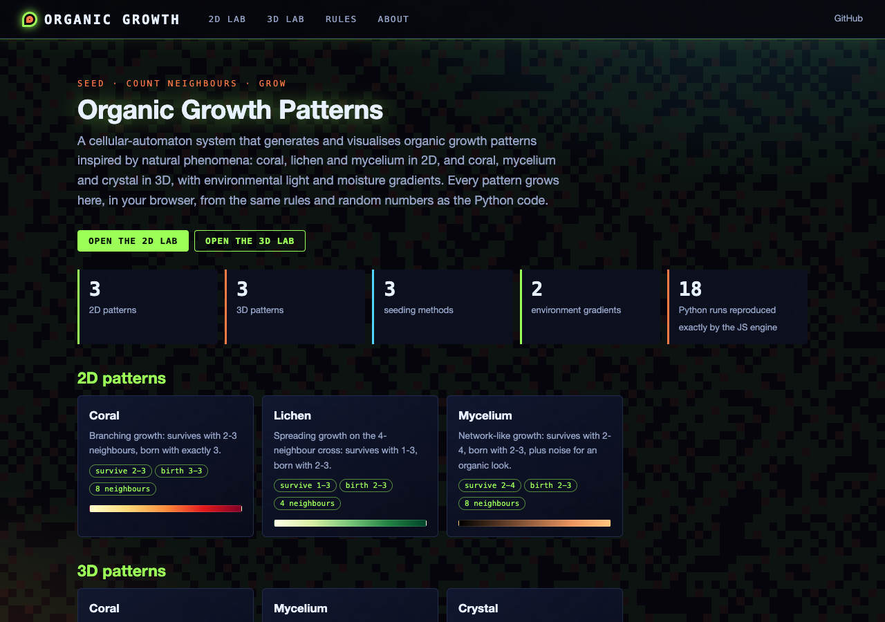
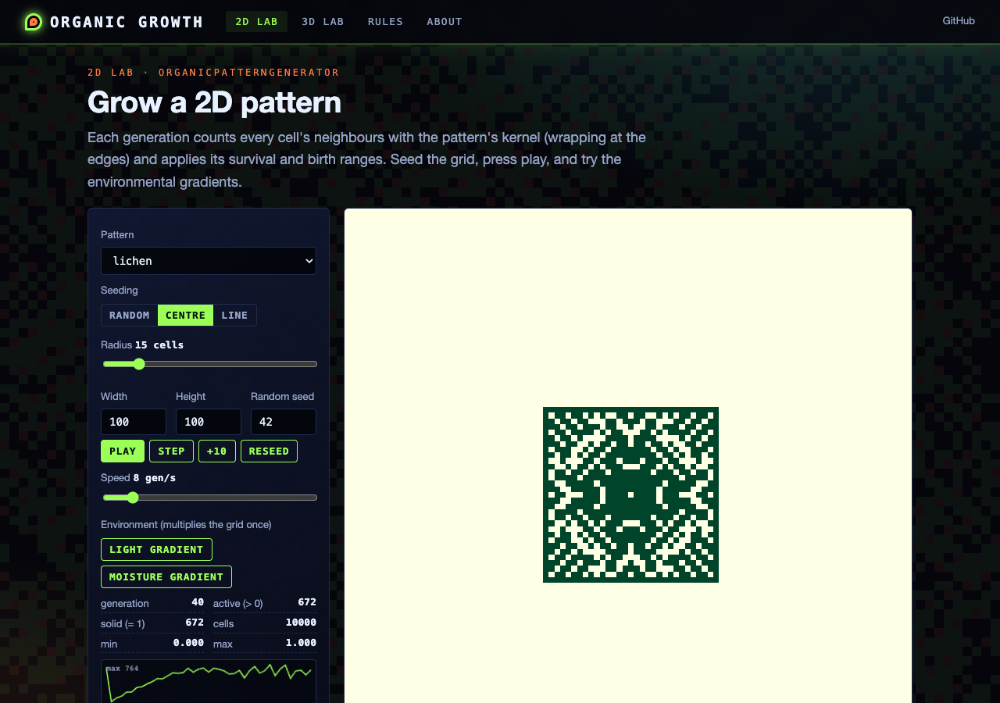
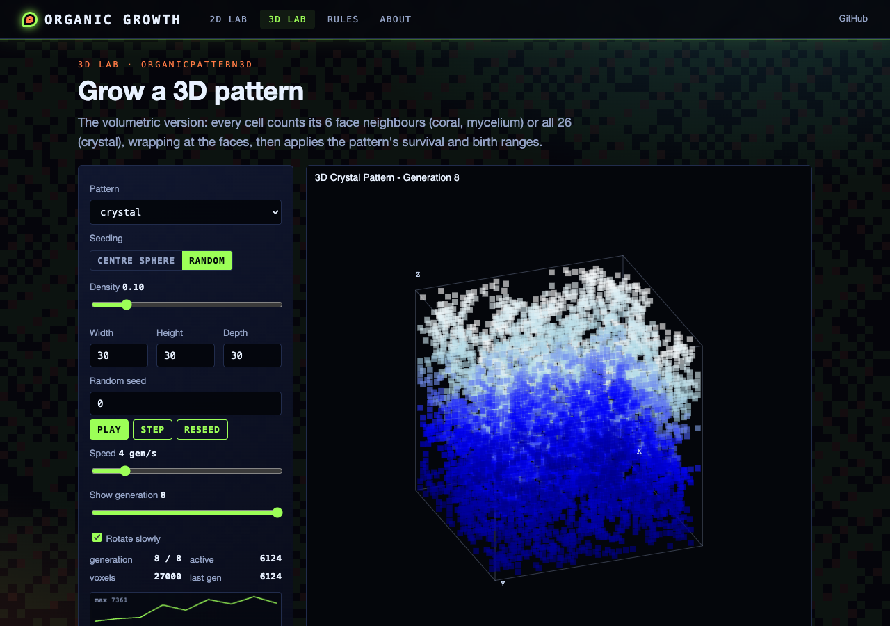
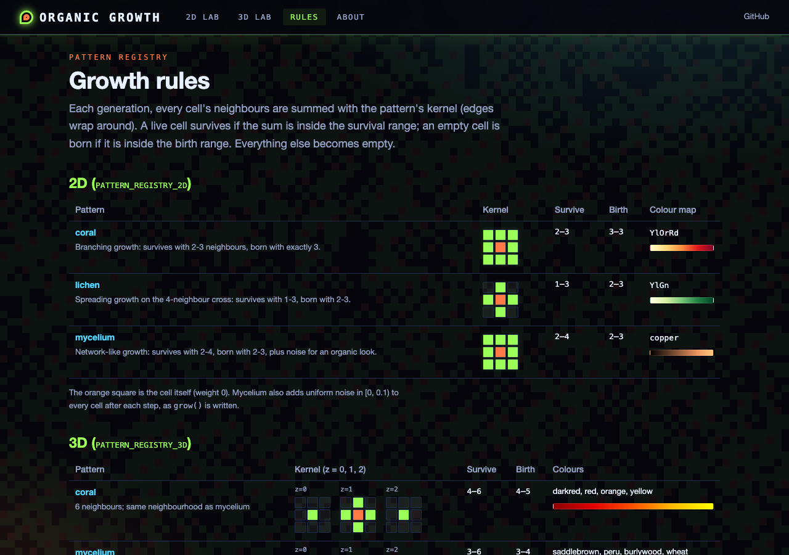

# Organic Pattern Generator

A Python-based cellular automaton system that generates and visualizes organic growth patterns inspired by natural phenomena like coral, lichen, and mycelium growth. The system combines cellular automata rules with environmental factors to create visually striking and biologically-inspired patterns.

## Features

### Multiple Growth Patterns
- **Coral Growth**: Branching patterns with yellow-orange-red coloring
- **Lichen Growth**: Spreading patterns with yellow-green visualization
- **Mycelium Growth**: Network-like patterns with copper tones

### 3D Growth (`organic_patterns_3d.py`)
- **Coral**, **Mycelium** and **Crystal** rules on a volumetric grid (6-neighbour or 26-neighbour kernels)
- Random and centre-sphere seeding, 3D scatter plots and GIF time-lapse export

### Seeding Methods
- Random distribution
- Center-point growth
- Linear initialization

### Environmental Factors
- Light gradients (radial influence)
- Moisture gradients (vertical influence)
- Customizable environmental effects

### Visualization
- Real-time pattern development tracking
- Custom color schemes for each pattern type
- High-resolution output images
- Progress tracking and statistics

## Installation

### Prerequisites
```bash
Python 3.7 or higher
```

### Required Libraries
```bash
pip install -r requirements.txt   # numpy, matplotlib, scipy
```

### Setup
```bash
git clone https://github.com/gddickinson/organic-growth-patterns.git
cd organic-growth-patterns
```

## Usage

### Basic Usage
```python
from organic_patterns import OrganicPatternGenerator

# Create a generator
generator = OrganicPatternGenerator(width=100, height=100)

# Initialize with random seeding
generator.seed_random(density=0.3)

# Grow the pattern
for i in range(30):
    generator.grow(pattern_type='coral')
    
# Visualize the result
generator.visualize(save_path='coral_pattern.png')
```

### Pattern Types
Each pattern type has unique growth characteristics:

```python
# Coral pattern
generator.grow(pattern_type='coral')    # Branching growth

# Lichen pattern
generator.grow(pattern_type='lichen')   # Spreading growth

# Mycelium pattern
generator.grow(pattern_type='mycelium') # Network growth
```

### Seeding Methods
```python
# Random seeding
generator.seed_random(density=0.3)

# Center seeding
generator.seed_center(radius=15)

# Line seeding
generator.seed_line()
```

### Environmental Effects
```python
# Add light gradient
generator.add_environment('light')

# Add moisture gradient
generator.add_environment('moisture')
```

## Web interface and static site

The generators also run in the browser: **https://gddickinson.github.io/organic-growth-patterns/** (published from
`main` by `.github/workflows/pages.yml`). The static site *is* the working app: `OrganicPatternGenerator` and
`OrganicPattern3D` are ported to small JavaScript engines (with numpy's MT19937 random numbers and `np.random.choice`), the
rules and colour maps are read from `pattern_base.py` and matplotlib, and node tests require the engines to reproduce runs
of the Python generators exactly (cell for cell, every count).

- **2D lab** (`#/grow`): coral, lichen and mycelium; random / centre / line seeding; step or play; light and moisture
  gradients; population curve; PNG export; the Python code that repeats your run.
- **3D lab** (`#/grow3d`): coral, mycelium and crystal as a rotatable scatter plot coloured by depth; scrub through the
  history like `create_timelapse()`; PNG export.
- **Rules** (`#/rules`): the kernels, survival/birth ranges, colour maps and environment gradients.
- In the local app, **Check with Python** replays your exact run through the real Python classes and compares.

Links can open a run already grown, e.g. `#/grow?pattern=lichen&seed=center&rng=42&gens=40`.

```bash
pip install -r requirements-web.txt
python run_web.py                          # http://127.0.0.1:8172
python -m pytest -q tests/test_web.py      # API, static build, fixture currency, node engine test
python scripts/build_static.py             # writes site/ (what GitHub Pages serves)
python scripts/make_growth_fixture.py      # regenerate tests/fixtures/growth_fixture.json after changing the rules
```

| Home | 2D lab |
|---|---|
|  |  |
| **3D lab** | **Rules** |
|  |  |

## Technical Details

### Growth Rules
The system uses cellular automata rules specific to each pattern type:

1. **Coral Pattern**
   - Survival: 2-3 neighbors
   - Birth: Exactly 3 neighbors
   - Branching growth characteristics

2. **Lichen Pattern**
   - Survival: 1-3 neighbors
   - Birth: 2-3 neighbors
   - Spreading growth behavior

3. **Mycelium Pattern**
   - Survival: 2-4 neighbors
   - Birth: 2-3 neighbors
   - Added noise for organic appearance

### Pattern Development
1. Initial seeding determines starting configuration
2. Growth rules applied iteratively
3. Environmental factors influence final pattern
4. Continuous monitoring of pattern statistics

## Example Outputs

Each pattern type produces distinctive visual results:

```
coral_random_gen_25.png    - Branching coral-like growth
lichen_center_gen_25.png   - Circular lichen spread
mycelium_line_gen_25.png   - Network-like mycelial growth
```

## Advanced Usage

### Custom Pattern Creation
```python
custom_pattern = {
    'kernel': np.array([[1, 1, 1],
                       [1, 0, 1],
                       [1, 1, 1]]),
    'survive_range': (2, 3),
    'birth_range': (3, 3),
    'color_map': 'viridis'
}
```

### Pattern Analysis
```python
# Get pattern statistics
active_cells = generator.grow()
print(f"Active cells: {active_cells}")
```

## Contributing

Contributions are welcome! Here are some ways you can contribute:

1. Add new pattern types
2. Implement new environmental factors
3. Improve visualization options
4. Optimize performance
5. Add new seeding methods
6. Enhance documentation

Please feel free to submit issues and pull requests.

## Future Enhancements

Planned features and improvements:

1. More pattern types (algae, fungal, etc.)
2. Rendered 3D surfaces (the 3D generator currently draws scatter plots)
3. Interactive pattern evolution
4. Pattern combination effects
5. Time-lapse animation generation
6. Pattern analysis tools

## License

This project is licensed under the MIT License - see the LICENSE file for details.

## Acknowledgments

- Inspired by natural growth patterns
- Built on cellular automata principles
- Created with assistance from Anthropic's Claude AI
- Visualization techniques adapted from scientific imaging

## Support

Please file any issues through the GitHub issue tracker.

---

*Note: This project is designed for both educational purposes and artistic exploration of organic growth patterns.*